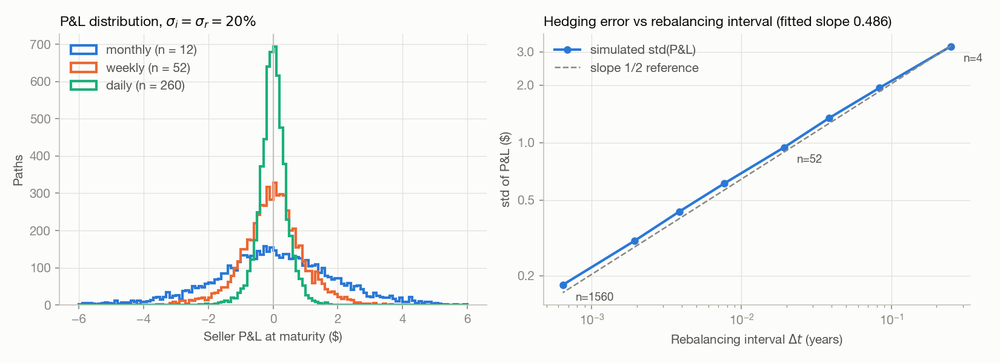
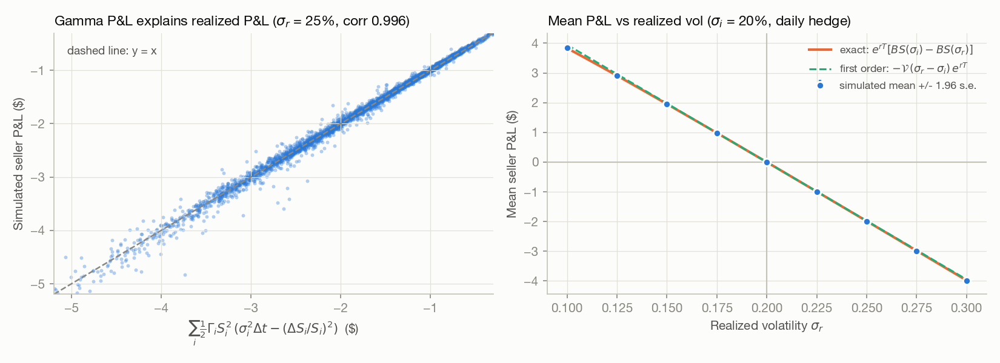
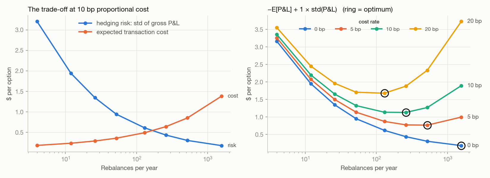

# hedgelab: option pricing and delta-hedging P&L analysis

A small object-oriented Python library for pricing European and American
options (closed form, CRR tree, Monte Carlo) and a discrete delta-hedging
simulator used to study hedging error, implied-vs-realized volatility P&L,
and the rebalancing-frequency / transaction-cost trade-off, with a multithreaded
C++17 core exposed to Python through pybind11.

The NumPy implementation is the reference; the C++ core is a from-scratch port of
the same algorithms and is tested against it.

## Layout

```
src/hedgelab/               Python package (NumPy reference implementation)
  instruments.py            Option (abstract) -> Call, Put, DigitalCall; payoff + exercise style
  models.py                 Model (abstract) -> BlackScholesModel; exact GBM path simulation
  black_scholes.py          vectorized price / delta / gamma / vega, with tau = 0 limits
  pricers.py                Pricer (abstract) -> AnalyticPricer, BinomialPricer, MonteCarloPricer
  hedging.py                DeltaHedger -> HedgeResult; backend="numpy" | "cpp"
cpp/                        C++17 core (namespace hedgelab), no Python dependency
  include/hedgelab/         black_scholes, binomial, monte_carlo, hedging, parallel
  src/                      implementations
  bindings/module.cpp       pybind11 module hedgelab._core
  tests/test_core.cpp       41 C++ checks (ctest)
CMakeLists.txt              static core library + C++ tests + Python module
tests/                      56 pytest tests: BS reference values, parity, Greeks vs finite
                            differences, CRR vs reference values, MC within 4 s.e., hedging
                            identities, and C++ vs NumPy cross-checks
experiments/
  hedging_study.py          reproduces every figure and table in Results (~10 s)
  benchmark.py              C++ vs NumPy vs pure-Python timings
```

**Design.** An `Option` only knows its payoff; a `Model` only knows its dynamics;
a `Pricer` combines the two. The `DeltaHedger` takes price paths, not a model, so the
world that generates paths (GBM today, Heston next) is independent of the model used
to compute hedge ratios. That separation is what makes the model-misspecification
study a one-line change.

```python
from hedgelab import BlackScholesModel, Call, Put, AnalyticPricer, BinomialPricer, MonteCarloPricer, DeltaHedger

model = BlackScholesModel(spot=100, rate=0.05, sigma=0.2)
AnalyticPricer(model).price(Call(100, 1.0))                      # 10.4506
BinomialPricer(model, 1000).price(Put(100, 1.0, american=True))  # 6.0896
MonteCarloPricer(model, 200_000, seed=1, antithetic=True).estimate(Call(100, 1.0))

t, S = BlackScholesModel(100, 0.05, 0.25).simulate_paths(1.0, 252, 10_000, rng=0)  # realized 25%
DeltaHedger(Call(100, 1.0), rate=0.05, hedge_sigma=0.20, cost_rate=0.001).run(t, S).summary()
```

## Results

Setup: short 1-year ATM call, S0 = K = 100, r = 5%, hedged at sigma_i = 20%,
6,000 paths on a 1,560-step grid (6 per weekday), paths simulated with drift r.
P&L is the seller's, in time-T dollars.

### 1. Hedging error shrinks like sqrt(dt)



| rebalances / year | std of P&L | mean P&L (s.e.) |
|---|---|---|
| 12 (monthly) | 1.939 | -0.013 (0.025) |
| 52 (weekly) | 0.944 | -0.008 (0.012) |
| 260 (daily) | 0.435 | -0.004 (0.006) |
| 1560 | 0.179 | -0.005 (0.002) |

Fitted log-log slope of std(P&L) against dt: **0.486** (theory 0.5).

### 2. Implied vs realized volatility



Per step, Taylor expansion plus the Black-Scholes PDE gives the seller's P&L

    dP&L_i ~ 1/2 Gamma_i S_i^2 (sigma_i^2 dt - (dS_i/S_i)^2)

Summed over the path this attribution has **0.996** correlation with simulated P&L
when realized vol is 25%. Under risk-neutral drift the hedge gains have zero mean, so
the mean P&L is exactly `e^{rT} [BS(sigma_i) - BS(sigma_r)]`; the simulation matches it
within Monte Carlo error at every sigma_r (e.g. -1.997 simulated vs -1.982 exact at 25%,
s.e. 0.013), and first-order `-vega (sigma_r - sigma_i)` is close near sigma_i.

### 3. Transaction costs and the optimal rebalancing frequency



Proportional cost on every trade (initial buy, rebalances, final unwind). Objective:
expected loss plus one standard deviation, `-E[P&L] + 1 x std(P&L)`.

| cost rate | optimal rebalances / year | mean cost | std of P&L |
|---|---|---|---|
| 0 bp | 1560 (grid max) | 0.000 | 0.179 |
| 5 bp | 520 | 0.427 | 0.338 |
| 10 bp | 260 | 0.643 | 0.485 |
| 20 bp | 130 | 0.987 | 0.687 |

Doubling the cost rate halves the optimal frequency. That is what the scaling predicts:
each rebalance trades |dDelta| ~ Gamma S sigma sqrt(dt), so rebalancing cost grows like
kappa sqrt(n) while hedging risk falls like 1/sqrt(n), and minimizing
a kappa sqrt(n) + b / sqrt(n) gives n* proportional to 1/kappa.

## C++ core

The C++17 core (namespace `hedgelab`, built as the Python extension `hedgelab._core`)
re-implements the Black-Scholes formulas, the CRR tree, European Monte Carlo and the
delta hedger. The Python layer chooses the backend:

```python
hedger.run(t, S)                      # NumPy reference
hedger.run(t, S, backend="cpp")       # same paths, C++ loop, all cores
hedger.simulate_gbm(model, 252, 1_000_000, seed=1)   # paths generated and hedged in C++
```

- **Correctness first.** On identical paths the C++ hedger matches NumPy P&L, costs and
  gamma P&L to 1e-10; CRR prices match to 1e-10; vectorized BS matches to 1e-12.
- **Deterministic multithreading.** Paths are split into fixed blocks and each block
  gets its own `mt19937_64` stream seeded from (seed, block index). No generator is
  shared between threads (no data race), and results are bit-for-bit identical for
  any thread count, which the tests check.
- **Memory.** `simulate_gbm` hedges each path as it is generated, so memory is
  O(steps) per thread instead of the O(paths x steps) arrays the NumPy version needs.
- **Bindings.** Heavy calls release the GIL; scalar BS functions are exposed through
  `py::vectorize`, so they broadcast like NumPy ufuncs.

### Benchmark

`python experiments/benchmark.py` on an Apple-silicon laptop (10 hardware threads,
Python 3.12, NumPy 1.26), best of 3 runs:

| task | implementation | time | speed-up vs NumPy |
|---|---|---|---|
| Delta hedge 20,000 given paths x 252 steps | pure Python loop (scaled from 500 paths) | 5,043 ms | |
| | NumPy, vectorized | 435 ms | |
| | C++, 1 thread | 141 ms | 3.1x |
| | C++, 10 threads | 20 ms | 21.6x |
| Simulate + hedge 200,000 paths x 252 steps | NumPy, vectorized (20k-path chunks) | 5,326 ms | |
| | C++, 1 thread | 3,489 ms | 1.5x |
| | C++, 10 threads | 452 ms | 11.8x |
| American put, CRR 5,000 steps | NumPy, vectorized per level | 236 ms | |
| | C++ | 7.6 ms | 31x |
| European call MC, 10M samples | NumPy, vectorized | 401 ms | |
| | C++, 1 thread | 422 ms | 0.9x |
| | C++, 10 threads | 39 ms | 10.3x |

Against a pure-Python loop doing the same per-path work, single-threaded C++ is 36x faster.

Reading the numbers:

- **Single-threaded C++ is not automatically faster than vectorized NumPy.** Where the
  work is random numbers and `exp` / `log` / `erfc`, NumPy already runs it in C. A
  libc++ `std::normal_distribution` draw measured 15.8 ns against 7.0 ns for NumPy's
  ziggurat generator, which is why one-thread Monte Carlo only ties.
- **C++ wins on loops NumPy cannot vectorize.** Backward induction is sequential in time;
  NumPy pays Python overhead and allocates new arrays at each of the 5,000 levels.
- **Fusing the hedging loop** (one pass per path, no paths x steps temporaries) gives 3x
  on one thread; the rest of the gain is parallelism across paths.

## Build and run

```bash
pip install -e ".[dev]" cmake pybind11
cmake -S . -B build -DPython_EXECUTABLE="$(which python)"
cmake --build build -j
ctest --test-dir build          # C++ tests
pytest                          # Python tests + C++ cross-checks (skipped if not built)
python experiments/hedging_study.py
python experiments/benchmark.py
```

The build writes `hedgelab/_core*.so` next to the Python sources. Without it everything
still runs on the NumPy backend (`hedgelab.HAS_CPP` is False).

## Roadmap

- Heston paths hedged with Black-Scholes deltas: residual vega risk from model misspecification
- Monte Carlo Greeks: bump-and-reprice vs pathwise vs likelihood ratio (variance and cost)
- Ziggurat normal generator in C++ to close the single-thread RNG gap
